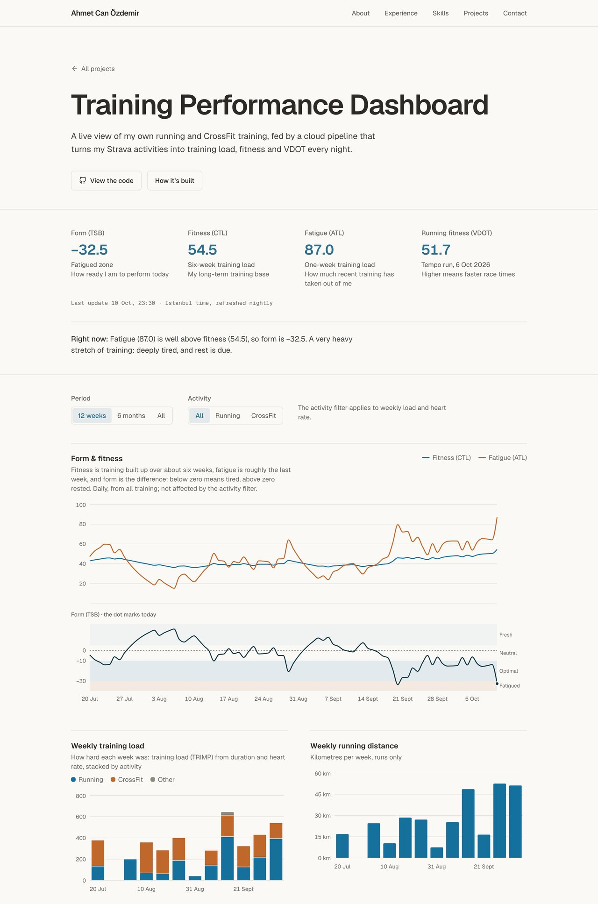
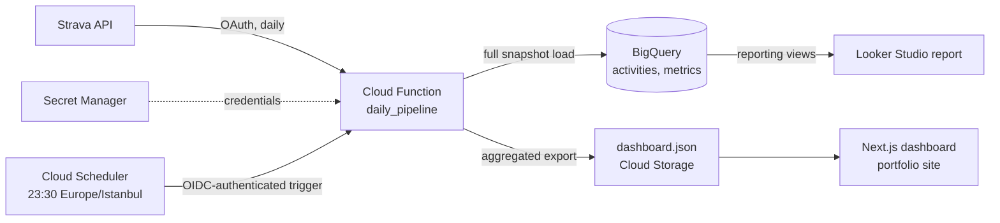

# Training Performance Dashboard

An end-to-end training analytics pipeline built on my own Strava data (running and CrossFit/HIIT).
Activities are ingested daily into BigQuery, sports-science load and fitness metrics are computed in
Python, and a small pre-aggregated JSON feeds a dashboard page on my
[portfolio site](https://github.com/ac-ozdemir/portfolio-website).

**Live dashboard:** [acozdemir.com/projects/training-performance-dashboard](https://acozdemir.com/projects/training-performance-dashboard)
· **Looker Studio report:** [same data, second presentation layer](https://datastudio.google.com/embed/reporting/6343fec2-11d3-4128-ac04-129ab38a34d7/page/su2AG)

> **Status:** in production since October 2026. The pipeline runs nightly; the metrics have been
> validated against an independent load model and real sessions
> ([validation notes](docs/validation-2026-10-08.md)).



## Architecture



Runs entirely on Google Cloud's free tier. The dashboard reads a static, pre-aggregated JSON file, so
the website holds no cloud credentials and never queries the warehouse directly.

Design choices worth calling out:

- **Full snapshot, not incremental.** The whole Strava history is three API pages, so every run
  rebuilds the `activities` table with a free load job. This picks up edits (renamed activities,
  races tagged after the fact) and deletions that an incremental merge would miss.
- **Least privilege.** Separate service accounts for the function runtime, the build and the
  scheduler. The runtime account can only touch its own dataset, bucket and secrets; the function
  rejects unauthenticated calls.
- **Self-healing credentials.** When Strava rotates the refresh token, the function stores the new
  one in Secret Manager and destroys the old versions.

## Metrics

| Metric | Method | Code |
| --- | --- | --- |
| TRIMP | Banister's exponential training impulse, from session duration and average heart rate | [`trimp.py`](pipeline/metrics/trimp.py) |
| CTL / ATL / TSB | Performance Management Chart: 42- and 7-day exponentially weighted load, form = the same day's CTL − ATL (fitness minus fatigue) | [`training_load.py`](pipeline/metrics/training_load.py), [`daily.py`](pipeline/metrics/daily.py) |
| Running fitness (VDOT) | Daniels & Gilbert, from races, interval reps and tempo blocks | [`vdot.py`](pipeline/metrics/vdot.py), [`workouts.py`](pipeline/metrics/workouts.py) |

All metric functions are pure and unit-tested. TRIMP was cross-checked against heart-rate TSS (a
lactate-threshold-based load model): r = 0.955 per activity, and the two models put 88% of days in
the same form zone ([validation notes](docs/validation-2026-10-08.md)). Caveats, stated rather than
hidden:

- TRIMP was designed for endurance sessions; for CrossFit/HIIT it is an approximation.
- Activities without heart-rate data count as zero load. Heart rate is only recorded consistently
  from November 2025, so the load series starts there, seeded with the opening period's mean load.
- VDOT points come only from runs I tag in Strava: *Race* (reserved for races actually run
  all-out) and *Workout*. A workout counts only if its laps and heart rate show the effort:
  intervals need at least two reps of 2.5–6 minutes at ≥ 90% of lactate-threshold heart rate
  (interval pace ≈ velocity at VO2max); tempo needs at least 15 minutes in 10–40-minute blocks at
  ≥ 95% (threshold pace ≈ one-hour race pace). Sessions on automatic 1 km laps and shorter reps are
  left out because they would overstate fitness.
- VDOT is a performance-based estimate, so it is labelled "running fitness", not VO2max. Garmin's
  physiological VO2max reads about 3 points higher after the same race.

## Repository layout

```
pipeline/
  main.py       Cloud Function entry point (orchestration + structured logging)
  config.py     resource names and athlete parameters
  strava/       API client and pure payload -> row mapping (GPS never leaves here)
  metrics/      pure metric functions (no I/O)
  warehouse/    BigQuery reads and snapshot loads
  export/       public dashboard.json builder and publisher
  schema/       BigQuery DDL and the Looker Studio reporting views
  alerting/     Cloud Monitoring alert on pipeline failures
  analysis/     validation and one-off analysis scripts
  scripts/      local one-off runs
  tests/        pytest suite
  deploy.sh     deploy function + scheduler (idempotent)
```

## Local development

```bash
cd pipeline
python3 -m venv .venv
.venv/bin/pip install -r requirements-dev.txt
.venv/bin/pytest
.venv/bin/ruff check . && .venv/bin/ruff format --check .
```

To run the whole pipeline once from a laptop, authenticate as the runtime service account and run:

```bash
gcloud auth application-default login --impersonate-service-account=pipeline-runner@training-performance-dashboard.iam.gserviceaccount.com
cd pipeline && .venv/bin/python -m scripts.run_local
```

`pipeline/.env.example` documents the Strava credentials for ad-hoc local scripts. `.env` is
gitignored and never uploaded (`.gcloudignore`); in the cloud the values live in Secret Manager.

## Deployment

```bash
cd pipeline && ./deploy.sh
```

Deploys the function (Python 3.12, `europe-west1`, private) and creates or updates the Cloud
Scheduler job that triggers it nightly.

## Privacy

- GPS / route data is never stored — the schema deliberately omits polylines and coordinates.
- Only the author's own activity data is processed.
- Public outputs carry no activity names or ids (race names excepted). The Looker Studio report
  connects only to reporting views that expose those safe columns, never to the base tables, and
  viewers cannot download its data.
- Data provided by Strava. Powered by Strava.
